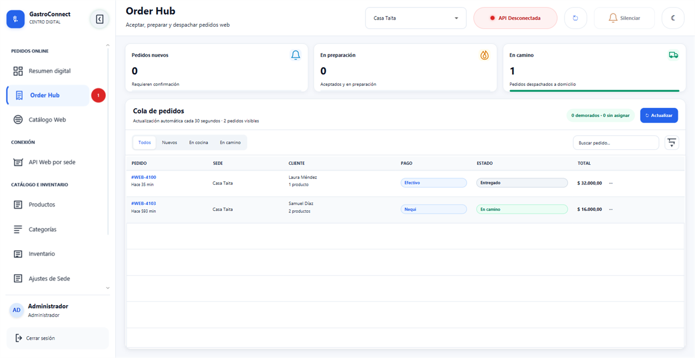
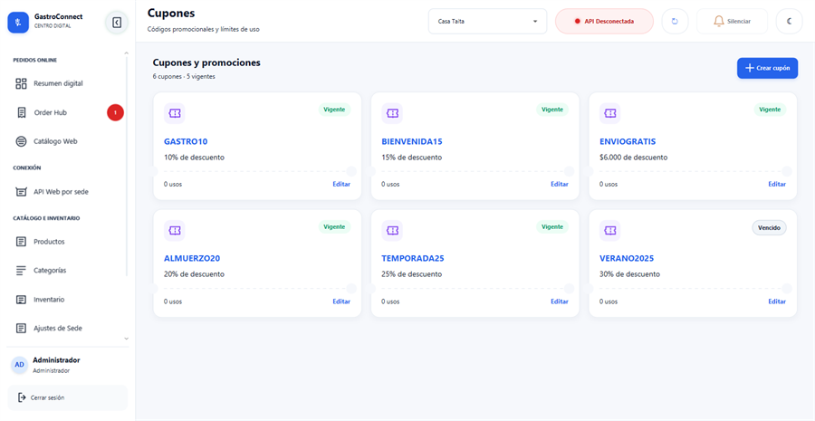
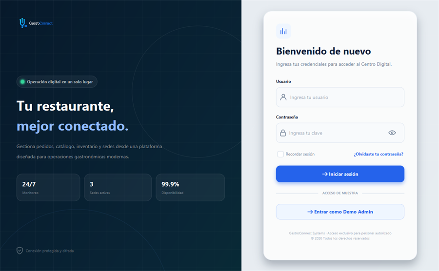

 

Soy **Ingeniero de Sistemas**. Construyo productos digitales completos: interfaz, lógica de negocio y base de datos, con criterios de **UX/UI**.

 

&nbsp;&nbsp;

 

---

## Sobre mí

Me interesa convertir necesidades reales en productos digitales que funcionen de verdad: claros para el usuario y Sostenibles en el tiempo. Trabajo con **desarrollo de escritorio y web, backend, bases de datos y diseño de interfaces**, normalmente cubro un proyecto completo, de la interfaz a la consulta SQL.

<table>
<tr>
<td valign="top" width="50%">

### Lo que construyo

* Aplicaciones de escritorio y web
* Interfaces y diseño de producto
* Frontend y backend
* Integración de servicios
* Herramientas internas con base de datos
* Sistemas multi-sede

</td>
<td valign="top" width="50%">

### En lo que me enfoco

* Experiencia de usuario
* Arquitectura de aplicaciones
* Modelado de datos y RLS
* Seguridad y control de acceso
* Soluciones que escalar con el tiempo
* Calidad: pruebas y documentación

</td>
</tr>
</table>

---

## Tecnologías

  

---

## Proyectos

### 01 · GastroConnect

**Sistema de gestión de restaurantes multi-sede** · JavaFX + PostgreSQL

*Centro de pedidos web: aceptar, preparar y despachar los pedidos de todas las sedes en tiempo real.*

<table>
<tr>
<td align="center" width="50%" valign="top">

**Cupones y promociones**

Descuento, compra mínima y usos por cliente, respetados en el total del pedido.

</td>
<td align="center" width="50%" valign="top">

**Acceso y seguridad**

Inicio de sesión con roles, credenciales cifradas y sesión por sede.

</td>
</tr>
</table>

**Qué cubre hoy**

<table>
<tr>
<td valign="top" width="50%">

**APLICACIÓN DE ESCRITORIO**

* Java 17 + JavaFX 21, modular, con Maven
* Interfaz en FXML y CSS, rediseñada desde Figma
* Módulos: catálogo, inventario, pedidos, sedes,
  cupones, facturación y API por sede
* Empaquetado con `jpackage`: instalador de Windows
  que no requiere Java instalado
* Tema claro y oscuro

</td>
<td valign="top" width="50%">

**BASE DE DATOS**

* PostgreSQL en Supabase: 21 tablas, 10 vistas
  y una vista materializada de ventas diarias
* Aislamiento por tenant y por sede con RLS
* La lógica de cálculo vive en la base: totales,
  folios correlativos, descuento de stock y cupones
* 39 funciones de negocio y 74 políticas RLS
* 168 pruebas end-to-end sobre la base real

</td>
</tr>
</table>

**Stack:** Java · JavaFX · Maven · PostgreSQL · Supabase · RLS · PL/pgSQL

---

### 02 · Menú digital · Fuego & Carbón

**Publicado** · [Repositorio](https://github.com/cristianagutierrezalc/pagdemodev) · [API](https://github.com/cristianagutierrezalc/backend-fuego-carbon)

Menú digital para restaurante con frontend y API separados. El backend en FastAPI quedó como **única fuente de verdad**: antes el frontend mantenía su propia copia del catálogo y se desincronizaba.

**Stack:** Python · FastAPI · HTML · CSS · JavaScript

---

### 03 · Web Cotizador Dev

**Publicado** · [Repositorio](https://github.com/cristianagutierrezalc/Web-Cotizador-Dev)

Herramienta web para que una agencia o un desarrollador comparta un enlace con sus clientes y ellos mismos calculen una estimación de inversión, en pesos colombianos.

**Stack:** HTML · CSS · JavaScript

---

### 04 · Sistema PITA

**Proyecto académico** · [Repositorio](https://github.com/cristianagutierrezalc/Pita-Project)

Programa Integrado de Transacciones Académicas, taller de Estructura de Datos. Lógica de cálculo de nómina, matrículas y promedios, con interfaz gráfica en Tkinter y persistencia en archivos.

**Stack:** Python · Tkinter · Estructuras de datos

---

### 05 · Otros proyectos

<table>
<tr>
<td valign="top" width="50%">

**[Doce papelitos](https://github.com/cristianagutierrezalc/Pagina-De-Amor)**

Página personal en HTML, CSS y JavaScript.

</td>
<td valign="top" width="50%">

**[Cachetona](https://github.com/cristianagutierrezalc/programa-para-volver)**

Aplicación Flask con interfaz web y registro de interacciones.

</td>
</tr>
<tr>
<td valign="top" width="50%">

**[demopage](https://github.com/cristianagutierrezalc/demopage)**

Versión inicial del menú digital con API y frontend.

</td>
<td valign="top" width="50%">

**[Este perfil](https://github.com/cristianagutierrezalc/cristianagutierrezalc)**

Repositorios públicos y privados del proyecto.

</td>
</tr>
</table>

---

## Formación

Mi formación principal es la **Ingeniería de Sistemas**, y mantengo un proceso constante de actualización en áreas relacionadas con tecnología y desarrollo de software.

<table>
<tr>
<td valign="top" width="50%">

**CIBERSEGURIDAD**

* Fundamentos de Ciberseguridad

</td>
<td valign="top" width="50%">

**BASES DE DATOS**

* Database Foundations
* Data Programming with SQL
* Data Programming with PL/SQL

</td>
</tr>
</table>

El objetivo es complementar el desarrollo de software con conocimientos sólidos en **datos, seguridad y arquitectura tecnológica**.

---

## Cómo trabajo

Entender el problema antes de escribir código. Ese es el orden en el que avanza cada proyecto:

<table>
<tr>
<td align="center">Idea</td>
<td align="center">→</td>
<td align="center">Análisis</td>
<td align="center">→</td>
<td align="center">Requerimientos</td>
</tr>
<tr>
<td align="center">UX / UI</td>
<td align="center">→</td>
<td align="center">Arquitectura</td>
<td align="center">→</td>
<td align="center">Desarrollo</td>
</tr>
<tr>
<td align="center">Pruebas</td>
<td align="center">→</td>
<td align="center">Documentación</td>
<td align="center">→</td>
<td align="center">Mejora</td>
</tr>
</table>

La prioridad es construir soluciones que no solo funcionen, sino que sean **claras, mantenibles y preparadas para evolucionar**.

<table>
<tr>
<td align="center" width="25%">

### Claridad

Código y estructuras fáciles de comprender.

</td>
<td align="center" width="25%">

### Escalabilidad

Soluciones preparadas para crecer.

</td>
<td align="center" width="25%">

### Experiencia

Interfaces pensadas desde el usuario.

</td>
<td align="center" width="25%">

### Evolución

Mejora continua de cada solución.

</td>
</tr>
</table>

---

## Actividad en GitHub

 

---

## Conectemos

Si quieres conocer mis proyectos, colaborar en una solución digital o hablar sobre desarrollo de software:

&nbsp;&nbsp;

 

